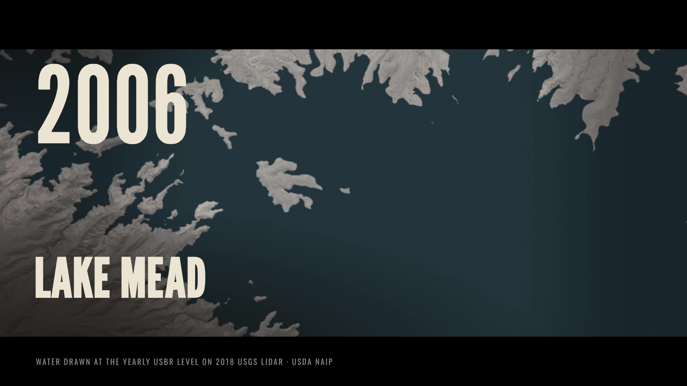
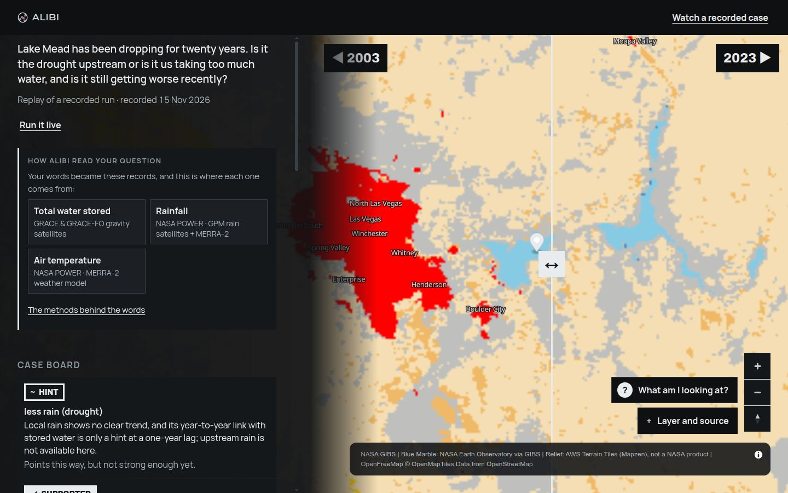
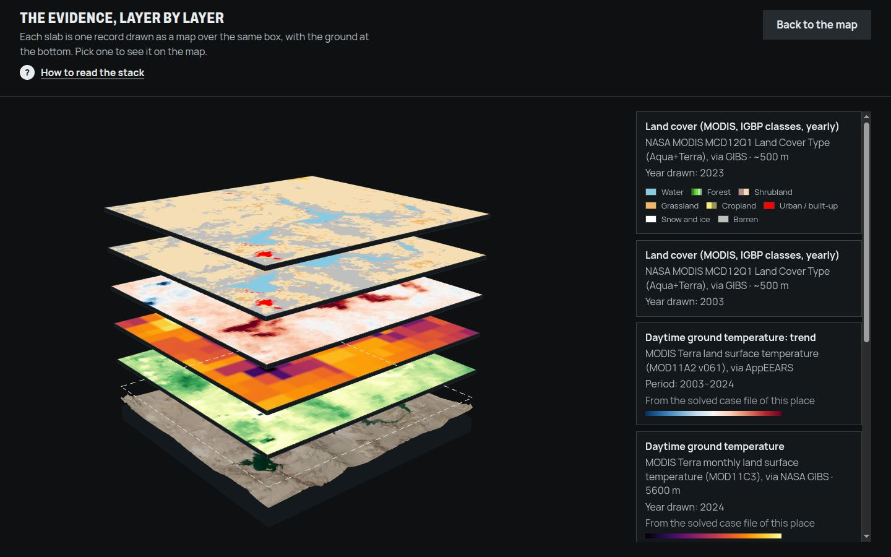
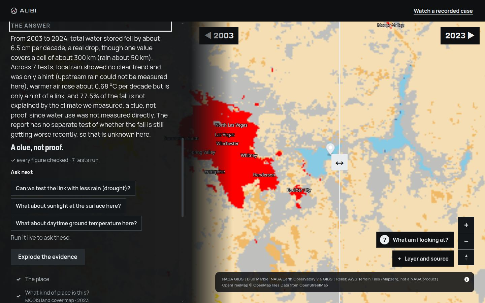
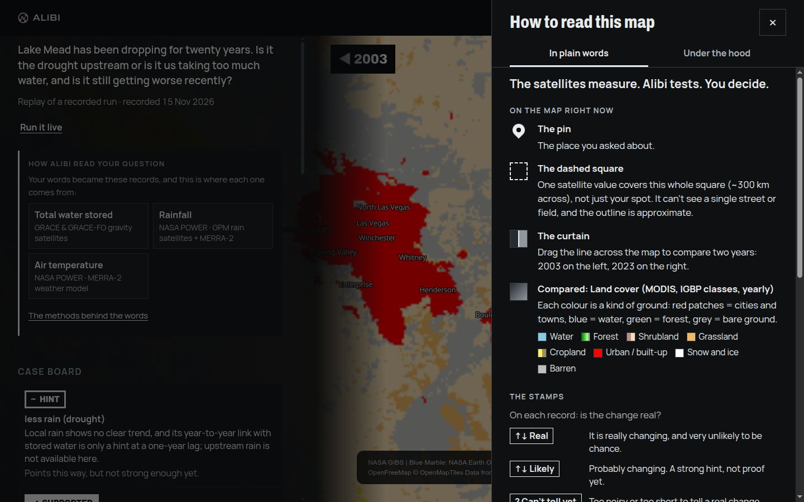
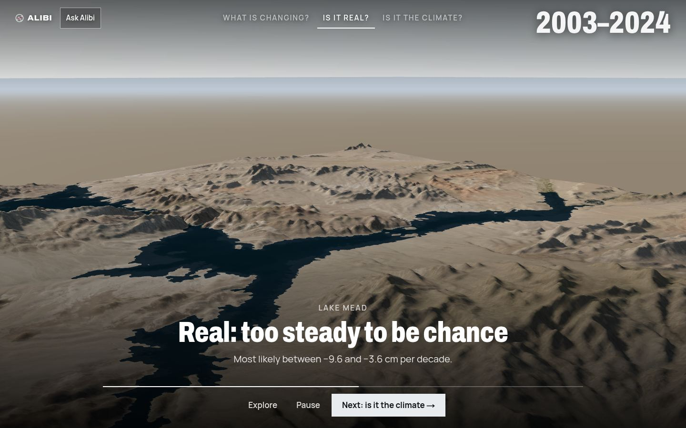
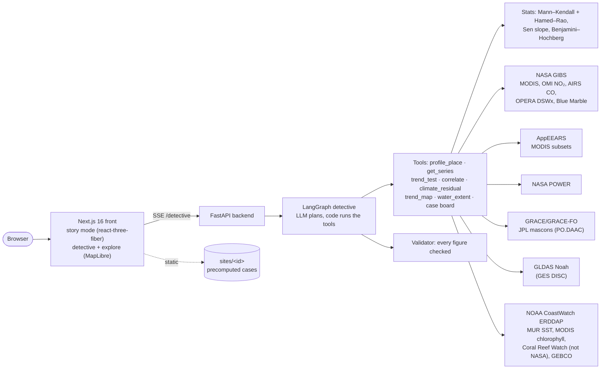

<div align="center">

<picture>
  <source media="(prefers-color-scheme: dark)" srcset="frontend/public/brand/alibi-mark.svg">
  
</picture>

# Alibi

### NASA-level tools. Everyday words.

*The satellites saw it all. Nobody told the story.*

Ask a question about a place in your own words. Alibi picks the NASA records that can answer it, tests whether
the change is real, and tells you in plain English what is real and what is only a clue.

**Live demo: `[LIVE_URL]`** · **[71-second film](frontend/public/video/alibi-hero.mp4)** · **[Deck](frontend/public/deck.html)** · [Challenge](https://www.spaceappschallenge.org/2026/challenges/earth-system-trend-detective/)


<a href="frontend/public/video/alibi-hero.mp4"></a>

<sub>Click the picture to open the film (MP4, 71 s, works muted).</sub>

</div>

---

## Contents

1. [What it does](#what-it-does)
2. [From your words to NASA tools](#from-your-words-to-nasa-tools)
3. [Four solved cases](#four-solved-cases)
4. [Honest by design](#honest-by-design)
5. [How it is built](#how-it-is-built)
6. [Data sources](#data-sources)
7. [Run it locally](#run-it-locally)
8. [Team, credits and use of AI](#team-credits-and-use-of-ai)

---

## What it does

NASA has watched every place on Earth for decades, and the data is public. Reading it takes tools few people
speak: gravity mascons, Mann–Kendall tests, false discovery rates. Alibi does that part and talks back in
everyday words. Three steps:

**1. Ask in your own words.** Pick a point on the globe and type a question. Alibi shows which records your words
became and where each one comes from.



**2. It picks the satellites and tests what changed.** Every record is laid over the same ground, so you can see
what was measured and how coarse it is.



**3. It answers in plain words, and says how sure it is.** Every figure in the answer is checked against the data
before you see it. Then it suggests what to ask next.



<details>
<summary><b>More screens:</b> the map guide and a solved case in 3D</summary>

"How to read this map" explains every mark on screen in plain words, including the dashed square that shows how
much ground one satellite value covers.



A solved case opens as a short documentary over the 3D relief, one question per chapter.



</details>

Screenshots: the recorded run at `/detective?replay=mead` and `/story/lake_mead`, taken at 1440 × 900.

---

## From your words to NASA tools

One real run, recorded on 15 Nov 2026 and committed as
[`backend/data/recordings/mead.json`](backend/data/recordings/mead.json) (replay it at `/detective?replay=mead`).

> *"Lake Mead has been dropping for twenty years. Is it the drought upstream or is it us taking too much water,
> and is it still getting worse recently?"*

| Plain words in the question | Record Alibi chose (catalog id → dataset) | Test | Result |
| --- | --- | --- | --- |
| "dropping", "too much water" | `grace_tws` → `TELLUS_GRAC-GRFO_MASCON_CRI_GRID_RL06.3_V4` (GRACE/GRACE-FO, JPL) | Trend, 2003–2024 | **Real**, down, −6.47 cm per decade |
| "still getting worse recently" | `grace_tws` | Trend, 2014–2024 | **Can't tell yet** |
| "the drought" | `precip` → NASA POWER (MERRA-2 + IMERG corrected) | Trend, 2003–2024 | **Can't tell yet** |
| (a climate driver Alibi added) | `t2m` → NASA POWER (MERRA-2) | Trend, 2003–2024 | **Real**, up, +0.68 °C per decade |
| "or is it us" | `grace_tws` against `precip`, `t2m`, rain over the past 12 months | Climate check | 77.5 % of the fall not explained by the climate measured: **a clue, not proof** |
| "drought upstream" | `grace_tws` and `precip`, year-on-year | Do they move together? (lag 0 and 1) | Lag 0: can't tell yet · lag 1: likely |

The run made 18 tool calls and 7 tests, all corrected together. The answer, as shown:

> From 2003 to 2024, total water stored fell by about 6.5 cm per decade, a real drop, though one value covers a
> cell of about 300 km (rain about 50 km). Across 7 tests, local rain showed no clear trend and was only a hint
> (upstream rain could not be measured here), warmer air rose about 0.68 °C per decade but is only a hint of a
> link, and 77.5% of the fall is not explained by the climate we measured, a clue, not proof, since water use was
> not measured directly. The report has no separate test of whether the fall is still getting worse recently, so
> that is unknown here.
>
> **A clue, not proof.** ✓ every figure checked · 7 tests run

---

## Four solved cases

Precomputed for 2003–2024, each one a 3D documentary at `/story/<id>` that turns into an instrument you can explore.
The figures below are copied from each case's `site.json`.

| Case | Headline from the data |
| --- | --- |
| [**Lake Mead**](sites/lake_mead/site.json) (USA) | Total water stored is going down for real (−6.5 cm per decade). Between 54% and 84% of that change is not explained by climate, depending on the climate model. |
| [**Aletsch Glacier**](sites/aletsch/site.json) (Swiss Alps) | Daytime ground temperature is going up for real (0.49 °C per decade). The climate we measured explains nearly all of that change — what a glacier should show. |
| [**Doñana wetlands**](sites/donana/site.json) (Spain) | Topsoil moisture is going down for real (−1.15 kg/m² per decade); total water stored is likely going down (−8.55 cm per decade). |
| [**Great Barrier Reef**](sites/great_barrier_reef/site.json) (Australia) | Sea temperature over the reef is going up for real (0.23 °C per decade). Heat stress at or above 4 °C-weeks: 1 reef-year in 2003–2013, 20 in 2014–2024. |

Lake Mead, Aletsch and the Great Barrier Reef lines are the `headline` field verbatim (Aletsch adds a short gloss); Doñana has no
headline field, so its line is built from the `variables` entries (verdict and Sen slope per decade).

---

## Honest by design

A trend detective is only useful if it never says more than the data does.

- **Every figure is checked.** A validator compares each number in the model's text with the computed results.
  A text with a figure no tool returned, a wrong direction, a cause claim, "proof" or statistics jargon is
  rejected; after the retries a fixed template is shown instead. The answer shows *✓ every figure checked*.
- **False discovery control across the whole conversation.** Benjamini–Hochberg runs over every test the thread
  has ever logged, follow-ups and forks included, so asking more questions cannot fish a "real" result out of
  noise.
- **"Can't tell yet" is a real answer.** Verdicts are *real*, *likely* or *can't tell yet*, from a Mann–Kendall
  test with the Hamed–Rao autocorrelation correction and Sen's slope with its interval. When a record is too
  short, Alibi says how many more years it needs.
- **The data cell is drawn, not hidden.** The dashed square on the map is the ground one value covers (about
  300 km for GRACE). If your place is smaller, the answer has to say so.
- **No cause claims.** The share of a trend the measured climate does not explain is *a clue, not proof*. A
  suspect on the case board is only "supported" when a test links it to the changing record and survives the
  correction; otherwise it stays a hint or "trend real · not linked".
- **Missing is said out loud.** A question about something that cannot be measured at that place gets "could not
  be measured", never a guess.

<details>
<summary><b>Where this lives in the code</b></summary>

| Guard | Code |
| --- | --- |
| Figure, direction, certainty and wording checks | [`backend/app/explain/validator.py`](backend/app/explain/validator.py), [`backend/app/detective/wording.py`](backend/app/detective/wording.py) |
| Benjamini–Hochberg over the thread's test family | [`backend/app/stats/fdr.py`](backend/app/stats/fdr.py), [`backend/app/detective/ledger.py`](backend/app/detective/ledger.py) |
| Trend test, Sen slope, verdicts | [`backend/app/stats/trend.py`](backend/app/stats/trend.py), [`backend/app/stats/verdict.py`](backend/app/stats/verdict.py) |
| Climate split (residual) | [`backend/app/stats/residual.py`](backend/app/stats/residual.py) |
| Case board statuses decided by code, not the model | [`backend/app/detective/board.py`](backend/app/detective/board.py) |
| Data cells | [`backend/app/detective/cells.py`](backend/app/detective/cells.py) |

The full event contract and every rule are in [`backend/app/detective/README.md`](backend/app/detective/README.md).

</details>

---

## How it is built



The language model (Claude, through OpenRouter or the Anthropic API) plans which tools to call and writes the
final words. It never computes a trend, never decides significance and never decides what the case board shows.

<details>
<summary><b>Repository map</b></summary>

```
backend/                 FastAPI API (Python 3.12, uv)
  app/detective/         the LangGraph detective: graph, tools, case board, ledger, wording rules
  app/stats/             trend test, Sen slope, false discovery rate, climate split
  app/extractors/        one module per source: GRACE, GLDAS, POWER, AppEEARS, GIBS, ERDDAP, OPERA water extent
  app/explain/           narrator, router and the figure validator
  catalog/               variables.yaml: every record Alibi can ask for, with its dataset id
  data/recordings/       recorded runs replayed in the UI (mead, aral)
  tests/                 pytest suite
frontend/                Next.js 16 app
  src/app/               routes: / (cover), /story/<id>, /detective, /investigate, /explore
  src/story/             3D story mode: terrain, camera, timeline, case panel
  src/features/          detective and explore screens
  public/                brand, film, deck
sites/<id>/              precomputed cases: site.json, layers, relief, imagery, yearly maps
video/                   sources of the films (HyperFrames)
docs/                    submission copy and team notes, see docs/README.md
```

</details>

---

## Data sources

| Source | Who | What Alibi uses it for |
| --- | --- | --- |
| [GRACE/GRACE-FO JPL mascons RL06.3](https://podaac.jpl.nasa.gov/dataset/TELLUS_GRAC-GRFO_MASCON_CRI_GRID_RL06.3_V4) (PO.DAAC) | NASA | Total water stored, the main record of the water cases |
| [NASA POWER](https://power.larc.nasa.gov/) (MERRA-2, IMERG, CERES) | NASA | Air temperature, rain, sunshine: the climate drivers |
| [GLDAS Noah 0.25° v2.1](https://disc.gsfc.nasa.gov/datasets/GLDAS_NOAH025_M_2.1/summary) (GES DISC) | NASA | Soil moisture and runoff |
| [MODIS](https://modis.gsfc.nasa.gov/) via [AppEEARS](https://appeears.earthdatacloud.nasa.gov/) | NASA | Monthly ground temperature, vegetation, snow, evapotranspiration for the solved cases |
| [GIBS](https://nasa-gibs.github.io/gibs-api-docs/) | NASA | MODIS land cover, ground temperature and vegetation maps; OMI NO₂ and AIRS CO; true-colour pictures; Blue Marble basemap |
| [OPERA DSWx-HLS](https://www.jpl.nasa.gov/go/opera/) via GIBS, scenes from CMR | NASA JPL | Open-water area per year |
| [NASADEM](https://lpdaac.usgs.gov/products/nasadem_hgtv001/) and HLS (LP DAAC) | NASA | 3D relief and cloud-free base imagery of the cases |
| [MUR SST](https://coastwatch.pfeg.noaa.gov/erddap/griddap/jplMURSST41mday.html) and [MODIS Aqua chlorophyll](https://coastwatch.pfeg.noaa.gov/erddap/griddap/erdMH1chlamday_R2022SQ.html) | NASA data, served by NOAA CoastWatch ERDDAP | Sea temperature and chlorophyll |
| [Coral Reef Watch degree heating weeks](https://coastwatch.noaa.gov/erddap/griddap/noaacrwdhwDaily.html) | **NOAA, not NASA** | Heat stress on corals |
| [GEBCO 2020](https://coastwatch.pfeg.noaa.gov/erddap/griddap/GEBCO_2020.html) via ERDDAP | **Not NASA** | Sea depth, to tell a sea from a lake |
| [AWS Terrain Tiles](https://registry.opendata.aws/terrain-tiles/) (Mapzen) | **Not NASA** | Relief on the detective globe |
| [OpenFreeMap](https://openfreemap.org/) / [OpenStreetMap](https://www.openstreetmap.org/copyright) | **Not NASA** | Map labels |
| U.S. Bureau of Reclamation, USGS 3DEP + USDA NAIP, swisstopo, IGN Spain PNOA | **Not NASA** | Lake Mead levels for validation; close-up relief and aerial photos for the drone view |

Every layer names its source on screen, and non-NASA sources say so.

---

## Run it locally

Requirements: Python ≥ 3.12 with [uv](https://docs.astral.sh/uv/), Node.js ≥ 20.

```bash
cp .env.example .env           # repo root; fill in the keys (names below)

# 1. API (FastAPI) on :8765
cd backend
uv sync
uv run uvicorn app.main:app --port 8765

# 2. Web app (Next.js 16) on http://127.0.0.1:5180
cd ../frontend
npm install
npm run dev                    # or: NEXT_PUBLIC_API_URL=http://localhost:8765 npm run build && npm run start
```

The four solved cases are precomputed in `sites/` and work without the API. The detective and explore need it.
Open the app at `127.0.0.1:5180` (it is in `allowedDevOrigins`; another host name renders but does not hydrate).

| Variable | Used for |
| --- | --- |
| `OPENROUTER_API_KEY` or `LLM_API_KEY` | The language model (planner, narrator). `LLM_API_KEY` is an Anthropic key and wins if both are set. |
| `NASA_TOKEN` | Earthdata Login token: GRACE (PO.DAAC) and GLDAS (GES DISC) |
| `APPEEARS_TOKEN` | AppEEARS session token: MODIS subsets |
| `CORS_ORIGINS` | Comma-separated web origins allowed to call the API (defaults cover localhost) |

<details>
<summary><b>Docker</b></summary>

Two containers, `api` and `web`, built from the repo root:

```bash
cp .env.docker.example .env.docker
docker compose up -d --build
curl -s http://127.0.0.1:8777/health      # {"status":"ok"}
# web on http://127.0.0.1:5190
```

`NEXT_PUBLIC_API_URL` is baked into the web image at build time, and `CORS_ORIGINS` on the API must name the web
origin. Details (internal notes, in Spanish): [`docs/deploy/DOCKER.md`](docs/deploy/DOCKER.md).

</details>

<details>
<summary><b>Tests</b></summary>

```bash
cd backend && uv run pytest -q          # backend
cd frontend && npm test                 # detective screen logic (node --test)
cd frontend && npm run typecheck        # tsc --noEmit
```

Counts on this commit (15 Nov 2026): backend 961 passed, frontend 202 passed.

</details>

---

## Team, credits and use of AI

**Team** (NASA Space Apps Challenge 2026, Málaga), challenge
[Be An Earth System Trend Detective!](https://www.spaceappschallenge.org/2026/challenges/earth-system-trend-detective/)

- **Mandy**: data, statistics, backend, 2D web, language model, deploy.
- **Ale**: 3D, story, copy, demo, pitch.

**Licence:** [Apache-2.0](LICENSE). Data belongs to its providers, credited above and on screen. Fonts: Archivo and
Manrope (Google Fonts). No NASA logo or insignia appears in the project.

### Use of AI

Space Apps 2026 calls this "SI"; the full declaration is in [`AI.md`](AI.md).

- **To build it.** Code, tests and English copy were written with the help of Claude (Anthropic) through Claude
  Code. Commits made with it carry a `Co-Authored-By: Claude` line. The team chose the method, the records and the
  cases, and reviewed and ran the code.
- **Inside the product.** Claude, called through OpenRouter or the Anthropic API, plans the investigation and
  narrates the answer. It never computes a number or decides a verdict, and its text is labelled as written by an
  AI narrator and checked figure by figure.
- **Media.** The film and the deck are built from real app screenshots and real satellite and aerial imagery; no AI imagery is shown as data.
- **Music.** The background music of the landing and web pitch films was generated with Google Lyria (AI), declared here and in the files' metadata. The 30-second submission video uses a separate instrumental track generated with Google Lyria 3 Pro (AI) through Artlist, declared in its description and metadata.
